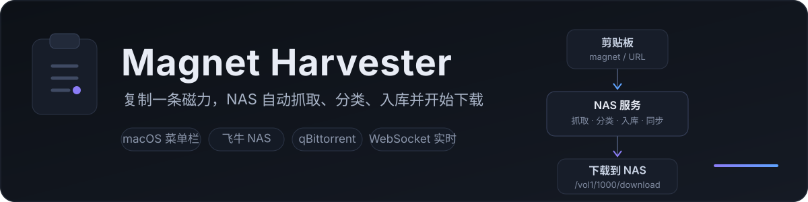
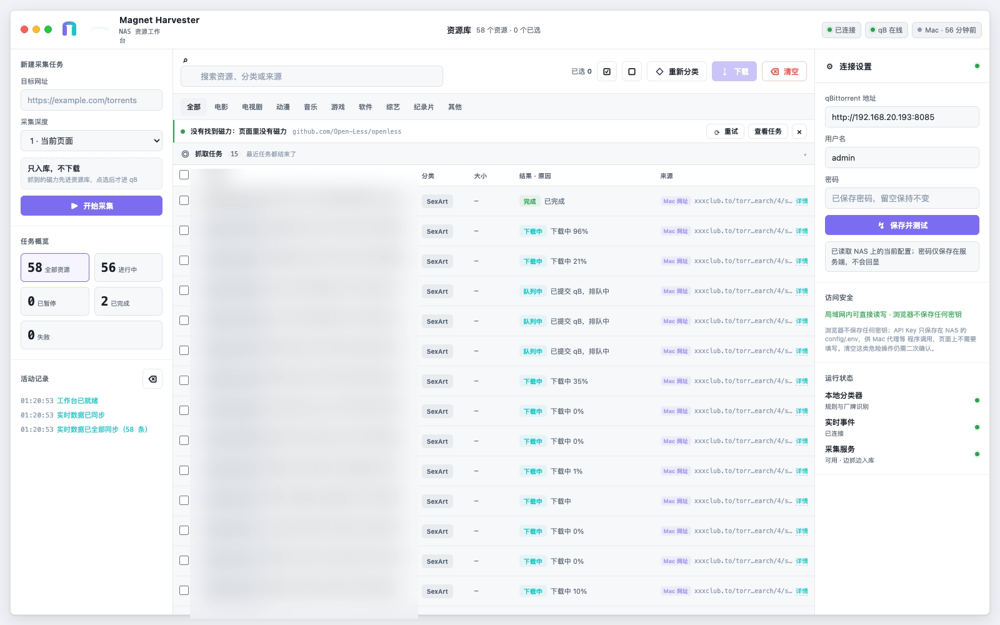
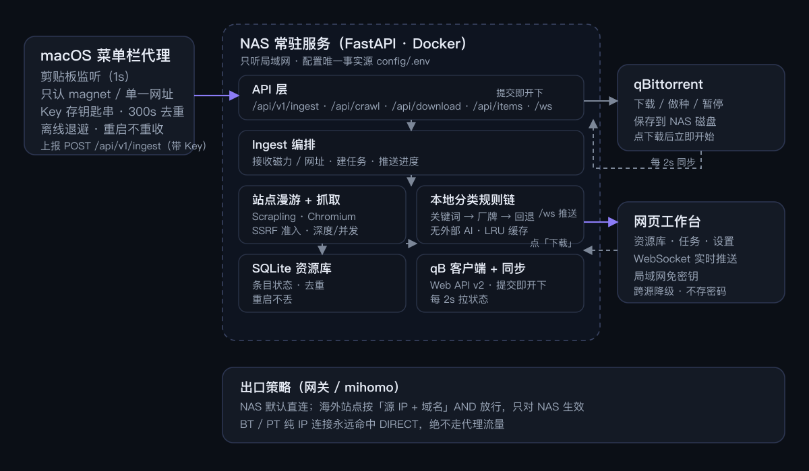

<p align="center">
  
</p>

<p align="center">
  <b>在 Mac 上复制一条磁力或网址，NAS 自动抓取、分类、入库并开始下载。</b><br>
  Mac 只保留一只只读剪贴板的菜单栏代理；解析、抓取、分类、入库、下载全部发生在 NAS。
</p>

<p align="center">
  
  
  
  
  
</p>

---

## 这是什么

Magnet Harvester（`qb-nas`）是一套**自托管的磁力采集 → 分类 → 入库 → 下载**流水线：

- 复制一条 `magnet:` 链接，或复制一个资源页网址；
- NAS 上的常驻服务自动抓页、提取磁力、按本地规则链分类、写入资源库；
- 在网页里勾选后点「下载」，qBittorrent 立刻开始下载——不需要再去 qB 里手动恢复；
- 全程实时推送到网页（任务进度、错误原因、下载百分比），不需要轮询刷新。

它适合：有 NAS、用 qBittorrent 下载、希望把「复制 → 找磁力 → 提交 → 手动开始」压缩成「复制」一步的人。

**设计取舍**：分类 100% 本地规则链，不调用任何外部 AI / API；Mac 代理只读剪贴板、不落全文；服务默认只监听局域网，浏览器不保存任何密钥。

## 界面



左侧是采集与活动日志，中间是资源库（分类筛选、搜索、批量操作），右侧是 qBittorrent 连接设置与运行状态；顶部实时显示 WebSocket、qB、Mac 代理三条链路是否在线。

## 工作流



- **可交互动效版**：[`docs/assets/architecture.html`](docs/assets/architecture.html)（单文件，浏览器打开即播数据流动效；GitHub 文件页只预览源码，不执行脚本）

一条磁力的完整路径：

1. **Mac 代理**每秒读取剪贴板，只匹配 `magnet:` 或「整段文本恰好是一个 http(s) 网址」，去重后 `POST /api/v1/ingest`；
2. **NAS 服务**的 ingest 层接单：网址交给站点漫游 + Scrapling 抓取，磁力直接解析 infohash；
3. **本地规则链**分类（关键词 → 工作室/厂牌 → 正则回退），写入 SQLite 资源库；
4. **网页**通过 WebSocket 实时收到新条目、分类结果与任务进度；
5. 用户点「下载」→ qB Web API v2 提交并**立即开始**；
6. **同步循环**每 2 秒读 qB 状态，下载进度与终态回推页面。

> 采集与下载是分离的：抓取任务只负责把磁力放进资源库，是否下载由你点选决定（界面上明确标注「只入库，不下载」）。

## 快速开始

### 0. 前置条件

| 角色        | 要求                                                                                     |
| ----------- | ---------------------------------------------------------------------------------------- |
| NAS         | 飞牛 fnOS 或任意 Linux，已装 Docker 与 Docker Compose；数据盘建议 ≥ 50 GB 空闲           |
| qBittorrent | Web UI 可访问（v4.1+，推荐 v5），建议与 NAS 部署在同一台机器                             |
| Mac（可选） | macOS 13+，装过 Xcode Command Line Tools（`xcode-select --install`），用于构建菜单栏代理 |

### 1. 在 NAS 上部署服务

服务以单个容器运行（镜像内自带 Python 依赖与 Chromium），配置、数据库、日志都在 bind mount 上，重建不丢。

在 Mac 的仓库目录里把源码同步到 NAS，再执行安装脚本：

```bash
# 1) 同步源码（排除虚拟环境与缓存）
rsync -a --exclude '.git/' --exclude '.venv/' --exclude 'node_modules/' \
  --exclude '__pycache__/' --exclude '.pytest_cache/' --exclude '.ruff_cache/' \
  ./ llll@192.168.20.193:/tmp/qbnas-src/

# 2) 在 NAS 上安装（幂等；已存在的配置与数据会保留）
ssh llll@192.168.20.193 \
  'cd /tmp/qbnas-src && bash deploy/install.sh --source /tmp/qbnas-src --commit <short-sha>'
```

`--commit` 会把本次构建对应的 commit 写进镜像标签与容器环境变量（`docker image inspect` → `org.opencontainers.image.revision`），线上镜像因此可追溯。

安装完成后脚本会打印：

```text
地址    http://<NAS-IP>:8899/
配置    /vol3/1000/qb-nas/config/.env        # 唯一配置事实源（600）
数据    /vol3/1000/qb-nas/data/magnet_items.db
日志    docker logs -f qb-nas-center
Key     /vol3/1000/qb-nas/api-key.txt        # 程序通道用，浏览器不需要
```

常用安装参数（完整列表 `bash deploy/install.sh --help`）：

| 参数                          | 说明                                                        |
| ----------------------------- | ----------------------------------------------------------- |
| `--prefix DIR`                | 安装根目录，默认 `/vol3/1000/qb-nas`（必须在存储空间 3 下） |
| `--port N` / `--bind-ip ADDR` | 对外端口（默认 8899）/ 只监听指定局域网地址                 |
| `--qbit-host/-user/-pass`     | 顺带写入 qB 连接信息，也可以在网页「连接设置」里填          |
| `--test`                      | 测试档：`/vol3/1000/qb-nas-test`、端口 18999，不碰正式目录  |
| `--prepare` / `--no-start`    | 只摆文件 / 只构建不启动                                     |
| `--commit SHA`                | 记录构建来源（推 GitHub 后用 `git rev-parse --short HEAD`） |

安装后跑一次自检（容器、健康、Key、挂载、配置事实源、只监听局域网、kill -9 自愈）：

```bash
ssh llll@192.168.20.193 'cd /vol3/1000/qb-nas && bash deploy/verify.sh --crash'
```

**升级**：重复上面的「同步 + install」即可，配置与数据库保留；**卸载**：`bash deploy/uninstall.sh`（默认保留数据，`--purge --yes` 连数据一起删）。

### 2. 构建并安装 Mac 菜单栏代理（可选，但推荐）

```bash
cd mac_agent
./build.sh                       # → build/NAS 剪贴板代理.app（无需 Xcode 工程）
open "build/NAS 剪贴板代理.app"   # 首次打开点「安装」
```

安装会做三件事：复制到 `~/Applications`、写入登录项 `com.qbnas.macagent`、引导保存 API Key 到钥匙串。

在菜单栏图标 →「设置」里填：

| 项       | 说明                                                         |
| -------- | ------------------------------------------------------------ |
| NAS 地址 | `http://192.168.20.193:8899`（局域网地址，不要写 localhost） |
| API Key  | 从 NAS 的 `api-key.txt` 复制；只存钥匙串，不落配置文件       |

菜单栏状态一眼可读：在线（绿）/ 离线（灰，自动退避重试）/ 暂停（暂停期间不读剪贴板）/ 无 Key（红）。运行数据在：

```text
~/Library/Application Support/QBNASMacAgent/
├── status.json   # 在线状态、队列长度、最近结果（无全文）
├── state.json    # 仅匹配到的链接，权限 600
└── agent.log     # 类型、哈希前 8 位、域名、结果
```

代理的行为边界：只读剪贴板、只认磁力与单一网址、扫描上限 16 KB、网址上限 2048 字符、本地 300 秒去重、重启不重收旧剪贴板、服务端拒收不无限重试。卸载在菜单里点「卸载」，或 `launchctl bootout gui/$(id -u) ~/Library/LaunchAgents/com.qbnas.macagent.plist`。

### 3. 第一次使用

1. 浏览器打开 `http://<NAS-IP>:8899`（同一局域网内默认免密钥，页面顶部显示「已连接 / qB 在线」）；
2. 左栏粘贴资源页网址 → 选深度 →「开始采集」；或在 Mac 上直接复制一条磁力；
3. 任务面板显示抓取页数、耗时、新增 / 重复条数、错误原因；
4. 资源库里按分类筛选、搜索，勾选后点「下载」——qB 立即开始，进度实时回到表格；
5. 想清空资源库：「清空」需要二次确认，接口层强制 `?scope=all`，避免误删。

## 使用说明

### 采集任务

- 深度 1 = 只抓当前页；2–3 会跟进详情页（受 `CRAWLER_MAX_DETAIL_LINKS` 限制）。
- 任务面板保留最近 20 条，`status` 为 `queued / running / done / failed`；失败原因会写明 `no_magnet`、`http_error`、`sslerror`、`timeout` 等，并保留触发 URL。
- 「只入库，不下载」是默认行为：采集只写资源库，不会自动提交 qB（除非你打开自动下载开关）。

### 资源库与下载

- 分类页签：电影 / 电视剧 / 动漫 / 音乐 / 游戏 / 软件 / 综艺 / 纪录片 / 其他；厂牌命中的条目直接用厂牌名作为分类（开放集合）。
- 支持搜索、重新分类、批量选择、批量下载；「来源」列可直接跳到原页面。
- 点「下载」后种子以 `queuedDL` 进入 qB 并**立即开始**；页面显示下载百分比，终态（完成 / 失败）会推送通知。
- 暂停不是失败：qB 里暂停的种子在页面上显示为「已暂停」，不会被误判为错误。

### 连接设置

- 右侧面板读的是服务端真实配置（密码不回显）；「保存并测试」会写 `config/.env` 并热替换 qB 客户端，无需重启。
- 局域网内浏览器不需要 API Key；API Key 只给 Mac 代理这类程序通道使用，且只走请求头，不进 URL。

### 实时推送

`/ws` 建连后先推一份全量快照，之后推增量事件；事件带 `updated_at` 版本号，前端会丢弃延迟到达的旧事件。断线自动重连，重连后重新对齐快照。

## 状态与错误说明

**资源条目**（`/api/items` 的 `status`）：

| 状态          | 含义              | 下一步                       |
| ------------- | ----------------- | ---------------------------- |
| `pending`     | 已入库，待分类    | 自动进入分类                 |
| `classified`  | 分类完成          | 可下载                       |
| `queued`      | 已提交 qB，排队中 | 等待 qB 调度                 |
| `downloading` | qB 正在下载       | 看百分比                     |
| `success`     | 下载完成          | —                            |
| `failed`      | 提交或下载失败    | 看 `error` 字段与任务面板    |
| `paused`      | qB 中暂停         | 在 qB 里恢复，页面状态会同步 |

**采集任务**（`/api/v1/status?jobs=N`）：`status` 四态 + `reason`（`no_magnet` 页面没有磁力、`http_error` 状态码异常、`sslerror` TLS/代理问题、`timeout` 超时、`robots` 被 robots.txt 拒绝）。

**健康检查**（`/api/health`）：`healthy`（服务自身）、`qbittorrent`（qB 登录/连通）、`classifier`（规则链可加载）。

**Mac 菜单栏**：在线 / 离线 / 暂停 / 无 Key / 队列 N 条 / 最近一次上报结果。

## 配置参考

配置文件只有一个：`/vol3/1000/qb-nas/config/.env`（600）。网页「保存并测试」写它、`install.sh` 幂等合并它、容器启动读它——**不要**在别处再维护第二份配置。优先级：文件 > 进程环境 > 内置默认；`SERVICE_HOST` / `SERVICE_PORT` / `STORE_DB_PATH` 由 compose 钉死。

| 变量                                                            | 说明                                                        | 默认              |
| --------------------------------------------------------------- | ----------------------------------------------------------- | ----------------- |
| `QBIT_HOST` / `QBIT_USERNAME` / `QBIT_PASSWORD`                 | qBittorrent Web UI 与凭据                                   | —                 |
| `QBIT_SYNC_INTERVAL`                                            | qB 状态轮询间隔（秒）                                       | `2.0`             |
| `AUTH_MODE`                                                     | `trusted`（局域网内直接读写）/ `strict`（写必须带 API Key） | `trusted`         |
| `API_KEY`                                                       | 程序通道 `X-API-Key`（Mac 代理等）；浏览器不使用            | 空（仅 loopback） |
| `TRUSTED_HOSTS`                                                 | 额外允许的 Host（域名/反代场景，防 DNS rebinding）          | 空                |
| `SITE_COOKIES`                                                  | 需要登录站点的 Cookie 注入，JSON `{"domain": "cookie"}`     | `{}`              |
| `CRAWLER_TIMEOUT` / `CRAWLER_MAX_DEPTH` / `CRAWLER_CONCURRENCY` | 抓取超时 / 最大深度 / 并发                                  | `30` / `2` / `6`  |
| `CRAWLER_ALLOWED_RESOLUTIONS`                                   | 只保留这些清晰度（逗号分隔）                                | `2160p,4k`        |
| `CRAWLER_ALLOW_FAKE_IP`                                         | 允许 mihomo/Clash fake-IP 作为抓取目标（SSRF 豁免）         | `false`           |
| `STORE_BACKEND` / `STORE_DB_PATH`                               | `memory` 或 `sqlite` 及数据库路径                           | `memory` / —      |
| `MIN_DISK_SPACE_GB`                                             | 磁盘告警阈值                                                | `10.0`            |
| `LOG_LEVEL` / `LOG_FILE`                                        | 日志级别与文件输出（轮转）                                  | `INFO` / 控制台   |

> 时间约定：数据与接口时间戳一律 **UTC-aware**，`updated_at` 用 naive-local ISO 以便前端按字典序比较；不要混入 aware-UTC，否则前端版本表会失序。

## 安全模型

- **局域网 trusted 模式**：同一网段可直接读写，浏览器不保存任何密钥；跨源请求自动降级为只读并按 403 拒绝写操作。
- **DNS rebinding 防护**：Host 头必须是真实地址或 `TRUSTED_HOSTS` 白名单，否则 403。
- **程序通道**：`API_KEY` 只接受 `X-API-Key` 请求头；WebSocket 走握手后第一帧，不把 key 放进 URL。
- **凭据**：qB 密码只存在 NAS 的 `config/.env`（600）与内存，接口不回显；Mac 的 key 只进钥匙串。
- **网络**：容器只监听局域网地址，根文件系统只读，可写面只有 `/config`、`/data`、`/logs` 与 tmpfs。

## 网络与网关（很重要）

NAS 的默认出口必须是**直连**（BT/PT 绝不能走代理），但抓取海外站点时需要放行对应域名。典型配置（mihomo，规则放在 `SRC-IP-CIDR,<NAS>/32,DIRECT` **之前**，并把源 IP 绑进条件，只对 NAS 生效）：

```yaml
rules:
  - AND,((SRC-IP-CIDR,192.168.20.193/32),(DOMAIN-SUFFIX,github.com)),GitHub Download
  - AND,((SRC-IP-CIDR,192.168.20.193/32),(DOMAIN-SUFFIX,pypi.org)),Package Download
  - AND,((SRC-IP-CIDR,192.168.20.193/32),(DOMAIN-SUFFIX,huggingface.co)),Model Download
  - SRC-IP-CIDR,192.168.20.193/32,DIRECT # NAS 其余流量（含 BT/PT）全部直连
```

判断链条：抓取报 `sslerror` / 超时 → 先在 NAS 上 `curl -v https://目标站`；再看网关日志有没有把 NAS 的流量判成 `DIRECT`；最后才怀疑服务本身。若使用 fake-IP，需要把 `CRAWLER_ALLOW_FAKE_IP=true`（或让目标域名走真实 IP）。

## 项目结构

```text
qb-nas/
├── magnet_harvester/          # FastAPI 服务（assembly 统一装配，无模块级可变全局）
│   ├── main.py  assembly.py  config.py  models.py
│   ├── crawler.py  site_walker.py  page_fetch.py  magnet_parser.py
│   ├── services/              # ingest / qbit_sync / item_queries / observability
│   ├── classifier/            # 关键词 → 厂牌 → 回退 规则链
│   ├── qbit_client/           # qB Web API v2（transport / mapper / submitter / sync）
│   ├── api/                   # REST / WebSocket / 静态页
│   ├── context/               # AppContext 依赖容器 · qB 配置热替换
│   └── utils/                 # SSRF 校验、鉴权、序列化、后台任务
├── static/                    # 无构建步骤的单页 Web UI
├── mac_agent/                 # macOS 菜单栏代理（Swift，build.sh 一键出 .app）
├── deploy/                    # install.sh / verify.sh / uninstall.sh / Dockerfile
├── docs/                      # 架构说明、ADR、验收记录、assets/、本地工作区说明
├── scripts/                   # preflight.sh（本地闸门）、smoke_production.py
├── tests/                     # 750+ 用例（pytest + pytest-asyncio）
└── .github/workflows/gates.yml # GitHub Actions：ruff + format + pytest
```

## 开发与验证

```bash
# 本地起服务
uv sync --extra dev --locked
uv run scrapling install          # 抓取用的 Chromium
cp .env.example .env              # 填 qB 连接信息
python run.py                     # http://localhost:8899

# 机器闸门（与 CI 同一套）
bash scripts/preflight.sh         # ruff check + format check + pytest
bash scripts/preflight.sh --fast  # 只跑 lint/format
```

- 测试基线：`python -m pytest -q` → **753 passed**；`ruff check` / `ruff format --check` 全绿。
- CI：push `main` / `stage/**` 与 PR 到 `main` 时由 GitHub Actions 跑同一套闸门（runner 内建 `.venv` 与 Chromium）。
- 真实链路验证：`deploy/verify.sh`（容器/挂载/配置/自愈）与 `scripts/smoke_production.py`（真 qB、真站点）；自动化测试不能替代它们。

## 故障排查

| 现象                              | 先看什么                                              | 常见原因                                                  |
| --------------------------------- | ----------------------------------------------------- | --------------------------------------------------------- |
| 抓取全部失败（`sslerror` / 超时） | NAS 上 `curl -v https://目标站`；网关日志             | NAS 出口被强制直连，海外站需要加 AND 放行规则             |
| 页面显示「没有找到磁力」          | 任务面板的触发 URL 与页数                             | 页面确实没有 `magnet:`；站点需要登录（用 `SITE_COOKIES`） |
| qB 显示离线 / 提交失败            | 右侧连接设置 →「保存并测试」；`docker logs`           | 地址、账号、密码或 qB 的 IP 白名单                        |
| 下载完成但页面不更新              | `/api/health`、WebSocket 状态                         | 同步循环异常或 WS 断线（会自动重连）                      |
| 修改配置后重启又回去了            | `docker logs qb-nas-center \| head -5` 的配置事实源行 | 改错文件；唯一事实源是 `config/.env`                      |
| 页面时间对不上                    | 时间戳约定                                            | 数据一律 UTC-aware；容器 `TZ=UTC` 只影响日志              |

日志与状态：`docker logs -f qb-nas-center`（UTC，便于对账）、`/api/health`、`/api/v1/status?jobs=20`、Mac 端 `agent.log`。

## 许可证

MIT
